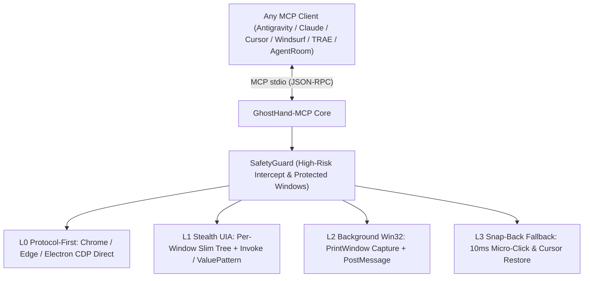

<h1 align="center">GhostHand-MCP</h1>

<p align="center">
  <strong>Stealth, Protocol-First Windows Desktop Automation MCP Server</strong><br />
  <strong>不抢物理鼠标 · 协议优先 · 极省 Token 的 Windows 桌面操控 MCP 服务端</strong>
</p>

<p align="center">
  
  
  
  
</p>

---

## 为什么选择 GhostHand-MCP？ / Why GhostHand-MCP?

传统 Windows 桌面操控插件普遍存在三大痛点：**疯狂抢占物理鼠标与窗口焦点**、**每步传全屏大图狂烧 Token**、**多步操作串行缓慢**。  
**GhostHand-MCP** 通过 **四层智能无感降级架构** 彻底解决这些问题——你在屏幕一侧打字或看视频，AI 在后台静默完成另一侧窗口的读取、填表、点击与等待，**物理鼠标纹丝不动**。



---

## 核心亮点 / Key Highlights

- **四层无感降级引擎 (Four-Layer Stealth Architecture)**
  - **L0 协议优先 (`CDP`)**：直连 Chrome / Edge / Electron 调试端口（默认 `9222`），毫秒级后台读写 DOM，零视觉开销、零鼠标干扰。
  - **L1 UIA 无感直调 (`UI Automation`)**：单窗口**语义瘦身树**（自动过滤不可见与空壳容器，省 **80%+ Token**）；点击走 `Invoke / Toggle / SelectionItem`，输入走 `ValuePattern.SetValue`（彻底告别中文输入法乱码）。
  - **L2 后台透视与消息直投 (`Win32`)**：`PrintWindow(PW_RENDERFULLCONTENT)` 后台透视抓图（被遮挡窗口也能直接拍下来，不切屏、不抢焦点）+ `PostMessage` 直投。
  - **L3 10ms 极速归位兜底**：检测到用户正在拖动鼠标时礼让 300ms 绝不死锁，点击后 10ms 内瞬间弹回原光标坐标。
- **本地批处理流水线 (`run_batch` + `wait_for`)**：1 次工具调用在本地连贯执行填表、点击、滚动、等待，大幅减少大模型往返轮次。
- **内置安全护栏 (`SafetyGuard`)**：自动拦截高危关键词（`支付 / 付款 / 转账 / 永久删除 / 格式化 / 卸载 / Pay / Purchase / Delete permanently / Format`）并支持 `protected_processes` / `protected_titles` 受保护窗口黑名单。
- **零开销扩展插槽 (`core/plugins.py`)**：预留 `VisionLocatorPlugin` 与 `GameBrainPlugin` 抽象接口，平时零内存与性能占用，随时可热插拔自定义视觉定位器或领域扩展。

---

## 快速安装 / Quick Start

```bash
# 1. 克隆仓库
git clone https://github.com/ruowaliweng-ship-it/GhostHand-MCP.git
cd GhostHand-MCP

# 2. 安装轻量依赖
pip install -r requirements.txt

# 3. 运行自动化测试（含 Windows 真机无感记事本实测）
pytest -v -s tests

# 4. 启动标准 MCP stdio 服务端
python server.py
```

---

## 10 个标准 MCP 工具 / 10 Core Tools

| Tool | Description |
| :--- | :--- |
| `list_windows` | Enumerate visible top-level windows (`hwnd`, `title`, `process`, `state`, `rect`) |
| `inspect_window` | Build a slim per-window semantic control tree `[id] Role "Name" (patterns)` |
| `capture_window` | Background `PrintWindow` screenshot (works when occluded, no focus steal) |
| `stealth_click` | Auto-fallback click: `L1 UIA -> L2 PostMessage -> L3 10ms snap-back` |
| `stealth_type` | Auto-fallback text input: `L1 ValuePattern -> L2 WM_CHAR` with read-back verification |
| `stealth_scroll` | Background scroll via `ScrollPattern` / `WM_MOUSEWHEEL` |
| `run_batch` | Execute multi-step action pipeline locally in one call |
| `wait_for` | Local polling until a control or text appears |
| `cdp_action` | Direct Chrome/Edge/Electron CDP protocol operations (`list_tabs`, `inspect`, `click`, `type`, `get_text`, `navigate`) |
| `clipboard` | Safe UTF-16 Windows clipboard read/write |

---

## 6 大主流 MCP 客户端接入配置 / Client Configurations

将以下配置中的 `python` 与 `server.py` 路径替换为你的本机绝对路径即可：

### 1. Antigravity (`mcp_config.json`)
```json
{
  "mcpServers": {
    "ghosthand": {
      "command": "python",
      "args": ["C:/path/to/GhostHand-MCP/server.py"]
    }
  }
}
```

### 2. Claude Desktop (`%APPDATA%\Claude\claude_desktop_config.json`)
```json
{
  "mcpServers": {
    "ghosthand": {
      "command": "python",
      "args": ["C:/path/to/GhostHand-MCP/server.py"]
    }
  }
}
```

### 3. Claude Code (`claude mcp add`)
```bash
claude mcp add ghosthand -- python C:/path/to/GhostHand-MCP/server.py
```

### 4. Cursor (`.cursor/mcp.json`)
```json
{
  "mcpServers": {
    "ghosthand": {
      "command": "python",
      "args": ["C:/path/to/GhostHand-MCP/server.py"]
    }
  }
}
```

### 5. Windsurf (`~/.codeium/windsurf/mcp_config.json`)
```json
{
  "mcpServers": {
    "ghosthand": {
      "command": "python",
      "args": ["C:/path/to/GhostHand-MCP/server.py"]
    }
  }
}
```

### 6. TRAE (`mcp_config.json`)
```json
{
  "mcpServers": {
    "ghosthand": {
      "command": "python",
      "args": ["C:/path/to/GhostHand-MCP/server.py"]
    }
  }
}
```

---

## 安全配置示例 / Safety Config (`ghosthand.config.json`)

在项目根目录创建可选 `ghosthand.config.json`（已列入 `.gitignore`）：

```json
{
  "protected_processes": ["KeePassXC.exe"],
  "protected_titles": ["Private Vault"],
  "high_risk_keywords": ["Confirm Wire Transfer"]
}
```

---

## 赞助支持 · Support

如果 **GhostHand-MCP** 帮你的 AI 工作流省下了大量时间与 Token，欢迎点一颗 **Star**，也可以请作者喝杯咖啡支持持续维护：

<p align="center">
  
</p>

## License

MIT License — see [LICENSE](LICENSE).
